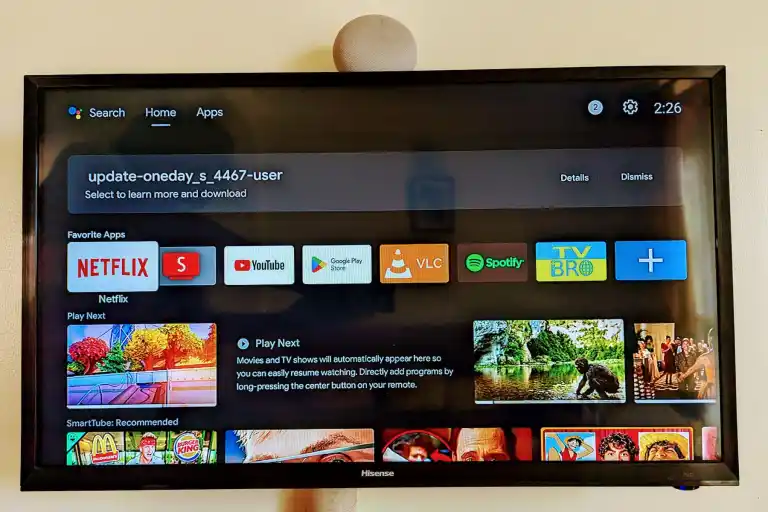
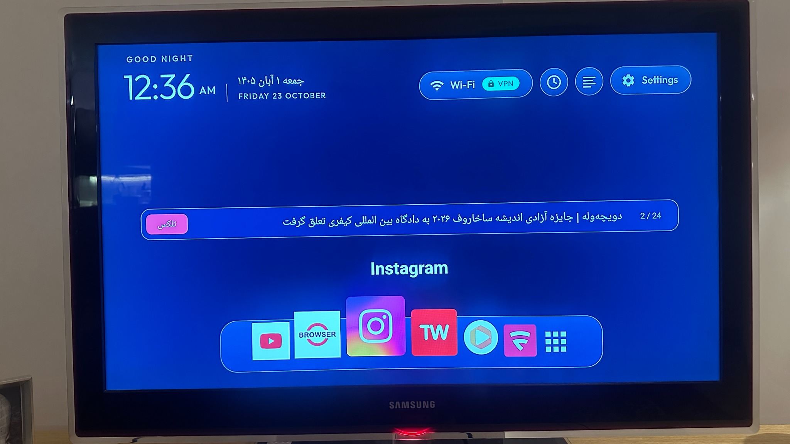

# لانچر فارسی CleanYourTV

**راهنمای قدم‌به‌قدم:** [نصب با مک](docs/INSTALL_MAC.md) · [نصب با ویندوز](docs/INSTALL_WINDOWS.md)

صفحه اصلی سفارشی برای Android TV با تاریخ شمسی، نوار برنامه‌های شبیه macOS، فهرست تمام‌صفحه برنامه‌ها و تلکس خبری فارسی.

این پروژه نسخه مستقل و غیررسمی از [CleanYourTV](https://github.com/Gathin23/cleanyourtv) است و وابستگی رسمی به سازنده اصلی، Apple، Google یا منابع خبری ندارد. این برنامه **لانچر است، نه سیستم‌عامل یا رام**؛ برای نصب آن به روت یا فلش دستگاه نیازی نیست.

## دانلود و نصب

**[دانلود APK آزمایشی — حدود ۱٫۹۴ مگابایت](https://github.com/xxamr/CleanYourTV-Persian-MacDock/releases/download/experimental-27e5fec-1-1/CleanYourTV-experimental.apk)**

[صفحه انتشار و مشخصات فایل](https://github.com/xxamr/CleanYourTV-Persian-MacDock/releases/tag/experimental-27e5fec-1-1) · [راهنمای نصب نسخه آزمایشی](docs/EXPERIMENTAL_APK.md)

نسخه آماده با نام **CleanYourTV Preview** و شناسه `com.gathin.tvhome.preview` کنار لانچر قبلی نصب می‌شود. تنظیمات آن جداست. امضای این فایل از نوع Debug و موقت است؛ نصب نسخه‌های بعدی روی آن تضمین نمی‌شود. نسخه پایدار هنوز منتشر نشده است.

۱. فایل APK را دانلود کنید.
۲. مطابق [راهنمای نصب](docs/EXPERIMENTAL_APK.md)، اتصال ADB را برقرار و برنامه را نصب کنید.
۳. ابتدا برنامه را از صفحه اصلی فعلی باز کنید و عملکرد ریموت را بسنجید.
۴. فقط پس از اطمینان، آن را در تنظیمات دستگاه به‌عنوان برنامه پیش‌فرض Home انتخاب کنید.

**لانچر اصلی دستگاه را حذف یا غیرفعال نکنید.** پیش از تغییر Home، نام برنامه و مؤلفه فعلی آن را ثبت کنید تا بتوانید برگردید.

حداقل نسخه تعیین‌شده در سورس، Android 8 یا API 26 است. استفاده قبلی روی Mi Box 4 با Android 9 توسط مالک گزارش شده؛ نصب، به‌روزرسانی و بازیابی APK آزمایشی روی دستگاه واقعی هنوز تأیید نشده است. بعضی Firmwareها تغییر Home را محدود می‌کنند.

## امکانات

- تاریخ شمسی با نام روز و ماه و ارقام فارسی.
- ساعت ۱۲ساعته و ساعت تمام‌صفحه با جابه‌جایی آرام؛ زبان ارقام و AM/PM به تنظیمات زبان اندروید بستگی دارد.
- نوار برنامه‌ها یا Dock با عرض حدود ۶۰٪ صفحه، آیکون اصلی برنامه‌ها و بزرگ‌نمایی آیکون انتخاب‌شده و همسایه‌ها.
- بازگشت بزرگ‌نمایی به حالت عادی پس از حدود ۳ ثانیه بی‌حرکتی.
- افزودن، حذف و مرتب‌کردن برنامه‌های دلخواه از روی تلویزیون با ریموت.
- فهرست تمام‌صفحه برنامه‌ها یا Launchpad.
- تلکس RSS فارسی با انتخاب منبع و موضوع، روشن/خاموش، تازه‌سازی دستی و کنترل خبر با ریموت.
- تلاش برای دریافت خبر هر پنج دقیقه، زمانی که صفحه اصلی فعال و تلکس روشن است؛ دریافت خبر تازه یا دسترسی همیشگی به منابع تضمین نمی‌شود.

این امکانات در کد وجود دارند؛ عملکرد و سرعت آن‌ها روی همه دستگاه‌ها آزمایش نشده است.

## قبل و بعد

| نمونه صفحه اصلی پیش‌فرض Android TV | صفحه اصلی سفارشی روی باکس مالک |
|---|---|
|  |  |

تصویر اول نمونه مرجع روی تلویزیون دیگری است. تصویر دوم عکس واقعی صفحه اصلی سفارشی روی باکس مالک است. این مقایسه، آزمون کنترل‌شده یک دستگاه و Firmware نیست و عکس دوم نیز نصب APK آزمایشی CI را اثبات نمی‌کند. تصاویر بدون بازسازی یا تولید مصنوعی منتشر شده‌اند. [توضیح تصاویر](docs/SCREENSHOTS.md)

## راهنماها

| موضوع | راهنما |
|---|---|
| شروع سریع و نصب فایل آماده | [نصب نسخه آزمایشی](docs/EXPERIMENTAL_APK.md) |
| اتصال ADB، انتخاب Home و بازگشت | [نصب و بازیابی](docs/INSTALL_FA.md) |
| ریموت، برنامه‌های دلخواه، ساعت و اخبار | [راهنمای استفاده](docs/USER_GUIDE_FA.md) |
| ساخت روی مک، ویندوز و لینوکس | [ساخت از سورس](docs/BUILD_FA.md) |
| اتصال ناموفق، خطا و صفحه سیاه | [رفع اشکال](docs/TROUBLESHOOTING_FA.md) |
| مجوزها، داده‌ها و محدودیت اخبار | [حریم خصوصی و RSS](docs/PRIVACY_AND_RSS.md) |
| کلید امضا و انتشار قابل به‌روزرسانی | [امضای نسخه انتشار](docs/SIGNING.md) |
| کنترل کیفیت پیش از انتشار | [فهرست کنترل انتشار](docs/RELEASE_CHECKLIST.md) |
| نتیجه آزمون‌ها و محدودیت‌های تأیید | [گزارش بررسی](docs/VERIFICATION.md) |
| منشأ سورس و تاریخچه پروژه اصلی | [نسبت با پروژه اصلی](docs/UPSTREAM.md) |
| همکاری در توسعه | [مشارکت](CONTRIBUTING.md) |
| مجوزها و نام پدیدآورندگان | [اعتبارها و مجوزها](CREDITS.md) |

[فهرست مستندات](docs/README.md) · [تغییرات](CHANGELOG.md) · [گزارش امنیتی](SECURITY.md) · [دستورالعمل عامل‌های برنامه‌نویسی](AGENTS.md)

## وضعیت ساخت و انتشار

ساخت اندروید با Java 17، سکوی API 34 و ابزار ساخت 34.0.0 در GitHub Actions موفق بوده است. نسخه آزمایشی پس از آزمون‌های JVM، بررسی lint، بررسی شناسه برنامه و تأیید امضای APK منتشر شده است. [اجرای ساخت APK](https://github.com/xxamr/CleanYourTV-Persian-MacDock/actions/runs/39853484103)

این موفقیت به معنی تأیید نصب یا آپدیت روی تلویزیون واقعی نیست. خروجی `assembleRelease` بدون تنظیمات خصوصی امضا، unsigned است و مستقیماً نصب نمی‌شود. فایل‌های Debug برای آزمایش‌اند؛ هیچ‌کدام را نسخه پایدار تلقی نکنید.

## مجوز و منشأ

بر پایه CleanYourTV، © ۲۰۲۶ Gathin و مشارکت‌کنندگان، تحت مجوز [MIT](LICENSE). فونت Outfit تحت [مجوز SIL OFL 1.1](launcher/FONT-LICENSE-OFL.txt) است. متن حقوقی اصلی این مجوزها حفظ شده است. مستندات تاریخی و فهرست دستگاه‌های پروژه اصلی، تأیید سازگاری نسخه سفارشی نیستند.
